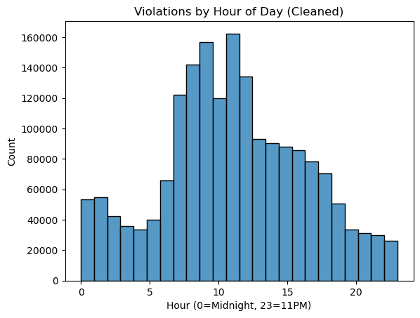
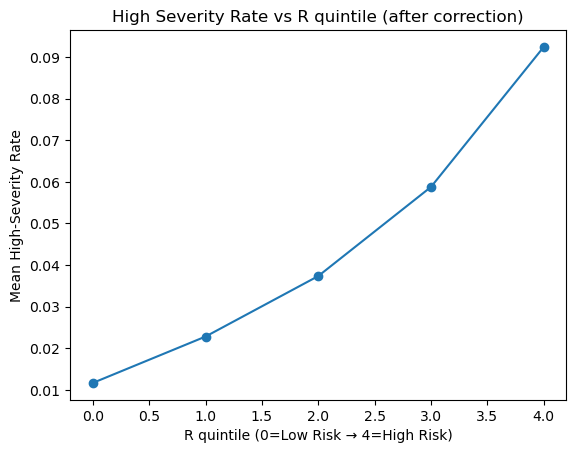

# NYC Parking Violation Risk Analysis

Exploring where and when NYC parking and traffic violations occur, how severe their fines are, and how an interpretable risk score relates to high-severity tickets.

**Author:** Tejasree Seelam · **Course:** ISYE 6740 · **Term:** Fall 2025

[Analysis notebook](Final%20Project.ipynb) · [Final report](Final_Project_Group_206.pdf)

## Overview

This academic project combines exploratory data analysis, feature engineering, a weighted risk index, and logistic regression using NYC violation records from **May 1–October 31, 2025**. It investigates temporal patterns, county/precinct differences, vehicle registration and license types, and fine severity.

The report describes a sample of **1,840,000 records**. The saved notebook output indicates **473,370 records** after removing missing and zero precincts. The original collector requests at most **10,000 tickets per day**, so the study uses a capped sample rather than all tickets issued in the period.

## Analysis workflow

1. Collect records from NYC Open Data and inspect missing values and category frequencies.
2. Explore violations by hour, weekday, month, registration state, county, and precinct.
3. Create rolling ticket-density and camera-like violation scores, temporal indicators, and registration/license features.
4. Calculate a composite risk score, assign risk tiers, and summarize frequent local violations.
5. Explore logistic regression and calibration at the precinct/day level, plus an R-score-only ticket-level baseline.
6. Load precinct boundaries for geographic analysis. The supplied notebook loads boundaries; the report contains the completed map.

### Risk score and target

The notebook's initial index is:

```text
R = clip(0.45 × camera_score
       + 0.35 × density_score
       + 0.15 × time_score
       + 0.10 × persona_score, 0, 1)
```

The `camera_score` is based on the local share of speed, bus-lane, and red-light violations; it does **not** measure physical camera locations or proximity. `density_score` uses rolling 30-day ticket counts normalized within each county/precinct. The later `R_fixed` experiment inverts the density and time scores before recomputing the index.

| Risk tier | Score |
| --- | --- |
| Low | R < 0.40 |
| Medium | 0.40 ≤ R < 0.70 |
| High | R ≥ 0.70 |

A ticket is labeled **high severity** when `fine_amount + penalty_amount ≥ $150`. This is a financial severity proxy. It is separate from the heuristic risk tier. The area/day model labels a day high severity if at least 20% of its observed tickets meet that threshold.

## Reported findings

These are historical results from the supplied report and saved notebook outputs, **not metrics reproduced during repository preparation**.

| Finding | Reported value |
| --- | --- |
| Average fine after precinct filtering | $78.69 |
| Average penalty after precinct filtering | $13.25 |
| R-score-only logistic regression ROC AUC | Approximately 0.6982 |
| High-severity tickets in reported test set | 6,336 of 142,011, approximately 4.46% |
| R-score logistic coefficient | 3.6143 |
| R-score logistic intercept | −4.0361 |

The report notes weak classification of the minority high-severity class despite good classification of low-severity tickets. Its fitted relationship is:

```text
P(high severity | observed ticket, R) = sigmoid(−4.0361 + 3.6143 × R)
```

A positive coefficient indicates an association within this sample. It does not establish causation or estimate the chance that a parked vehicle will receive a ticket: the dataset contains observed tickets, with no unticketed comparison group or parking-exposure denominator.

### Visuals from the original notebook

These figures were extracted from the supplied notebook's saved outputs and have not been regenerated.





## Repository contents

```text
.
├── README.md
├── Final Project.ipynb             # Publication copy of the analysis
├── requirements.txt               # Suggested dependency ranges
├── violations.csv                 # Supplied one-row example, not the study data
├── nyc_police_precincts.geojson
├── Final_Project_Group_206.pdf
├── violations-by-hour.png
└── severity-by-risk-quintile.png
```

## Running the notebook

Use Python 3.10 or newer. From the repository root:

```bash
git clone https://github.com/tejaseelam/nyc-parking-violation-risk.git
cd nyc-parking-violation-risk
python3 -m venv .venv
source .venv/bin/activate
python -m pip install -r requirements.txt
jupyter lab
```

On Windows, activate the environment with `.venv\Scripts\activate`.

Open `Final Project.ipynb` and run its setup cell. The full analysis CSV is **not included**. To use the original study data, place it in the repository root as:

```text
nyc_parking_2025-05-01_to_2025-10-31.csv
```

Then skip the two optional collection cells and begin at the pandas load cell. Alternatively, explicitly execute the two collection cells to request the historical date range from NYC Open Data. An optional Socrata token can be supplied through the `SOCRATA_APP_TOKEN` environment variable; no token is stored in this repository.

The collector retains the original 10,000-record daily cap to reflect the study design and stops on request failure. It does not paginate beyond that cap. Source availability, API behavior, and updated records may prevent an exact recreation of the historical sample. The one-row `violations.csv` is a schema example and cannot support rolling features, training, or model evaluation.

## Reproducibility and limitations

- **Publication changes:** repaired accidentally pasted code in the collection cell, directed CSV outputs to the repository root, replaced the unavailable shapefile path with the supplied GeoJSON, removed the inline package install, and completed the final R-score logistic regression fit/evaluation. Stale notebook outputs and execution counts were cleared; two saved figures are retained separately above.
- **Validation:** all notebook code cells were checked for Python syntax. A full execution and dependency compatibility check have not been performed because the complete study CSV was not supplied.
- **Sampling and coverage:** the daily cap and removal of zero/missing precincts can change the observed violation mix, particularly camera-related records. Counts are not adjusted for traffic volume or parking exposure.
- **County and spatial quality:** inconsistent county abbreviations and implausible county/precinct combinations require reconciliation before interpreting local risk or building a reliable map.
- **Temporal leakage:** rolling features include the current day, normalization uses the full period, and score directions were adjusted after examining severity. These choices need redesign for a prospective forecasting evaluation.
- **Target leakage in the area/day experiment:** mean fine and mean penalty are predictors of a target derived from the same amounts. Its saved AUC near 0.90 should not be treated as evidence of future ticket prediction. The ticket-level R-only baseline is a separate experiment.
- **Evaluation:** the ticket-level split is random rather than chronological. The area/day split is by row after sorting dates and can divide one date across train and test. Use disjoint date ranges and training-only transformations for future work.
- **Exploratory score versions:** early risk boards use `R`; later cells use `R_fixed`. They should not be interpreted as one consistent final score. The weights are heuristic and sum to 1.05 before clipping.
- **Report versus code:** the report discusses camera proximity, rental/EV features, and a completed warning map. The supplied notebook implements a camera-like violation proxy, registration/license features, and boundary loading; it does not contain all those proposed capabilities.

## Data sources and attribution

The notebook queries NYC Open Data dataset [`nc67-uf89`](https://data.cityofnewyork.us/resource/nc67-uf89.json). The report instead cites [Parking Violations Issued – Fiscal Year 2024](https://data.cityofnewyork.us/City-Government/Parking-Violations-Issued-Fiscal-Year-2024/pvqr-7yc4/about_data); these are different dataset identifiers, so use the notebook endpoint when investigating this analysis's provenance rather than assuming the sources are interchangeable.

The report's boundary reference is [NYC Police Precincts on ArcGIS Hub](https://hub.arcgis.com/datasets/c35786feb0ac4d1b964f41f874f151c1_0/about). A copy of the supplied precinct GeoJSON is included in the repository root.

The original report is included unchanged. Source datasets remain subject to their providers' terms. No additional software license is assigned in this repository.
